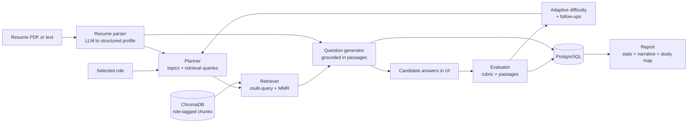

# Viva: a RAG-powered, role-based interview screener

Viva simulates a structured technical interview. Questions are **not predefined**. Each one is written on the fly from
three inputs: the candidate's resume, the selected role, and passages retrieved from a role-specific textbook corpus.
Answers are graded against the same passages, and the interview adapts as it goes.

Built for the PGAGI AI/ML & Backend Engineering Intern assignment.

| Layer | Choice |
|---|---|
| Frontend | Next.js 14 (App Router), TypeScript, Tailwind |
| Backend | FastAPI, SQLAlchemy 2, Pydantic v2 |
| Database | PostgreSQL (SQLite works for quick local runs) |
| Vector DB | ChromaDB (persistent, cosine space) |
| Embeddings | `BAAI/bge-small-en-v1.5` via sentence-transformers (local, no API cost) |
| LLM | Groq (`llama-3.3-70b-versatile`) behind a small `LLM` protocol |

## How it works



**Per question, the pipeline is `context -> question -> answer -> storage`**, and every step is persisted on the
`questions` row: the plan topic, the resume signals that motivated it, the retrieval queries, every retrieved passage
(flagged *used* or *not used*, with similarity and page range), the question, the hidden grading rubric and the model's
stated rationale. The UI shows this as marginal notes beside each question ("how this was written"), so the question
generation is fully traceable.

### The interview lifecycle

1. **Candidate entry.** Upload a PDF/TXT resume (or paste text), pick a role and a format (*Interview* hides feedback until the report; *Practice* shows it after each answer).
2. **Resume processing.** Text is extracted (PyMuPDF), then an LLM extracts skills, technologies, domains, projects, seniority and ML exposure into a validated schema. If the model is unavailable, a keyword fallback keeps the flow alive.
3. **Context construction.** The planner combines the role's syllabus with the resume to produce an ordered list of topics. About 60% are anchored in resume evidence, at least one probes a syllabus area the resume does not evidence, and each topic carries 2-3 textbook-style retrieval queries.
4. **Retrieval (RAG).** Queries run against the role's chunks in Chroma. Candidates from all queries are pooled, scored by their best query match, filtered by a relevance floor, and re-ranked with **MMR** so the context is relevant *and* diverse.
5. **Question generation.** The model sees only the retrieved passages, the topic, the target difficulty and question type, and a compact candidate profile. It returns the question, 3-5 expected points (hidden rubric) and a rationale. A Jaccard check rejects near-duplicates and retries once.
6. **Interactive interview.** Sessions are persisted, so a refresh resumes where you left off. Drafts are autosaved locally.
7. **Adaptation.** Strong answers (>= 8) raise difficulty, weak ones (<= 4) lower it. A weak answer also triggers a **follow-up** on the same topic, retrieved using the gaps the evaluator named (max 2 per interview).
8. **Report.** Weighted score (harder questions count more), band and recommendation, topic scores, a score/difficulty trajectory, strengths and gaps, a **study map** pointing to the exact book sections behind weak answers, and the full Q&A transcript with sources. Downloadable as JSON.

## Run it

### Prerequisites
- A free Groq API key: <https://console.groq.com>
- The knowledge-base PDFs from the assignment (see *Knowledge base* below)
- Docker, **or** Python 3.11+ and Node 20+

### Option A: Docker Compose

```bash
cp .env.example .env            # add GROQ_API_KEY
# put the book PDFs in backend/data/books/ (see below)
docker compose up --build
docker compose exec backend python -m app.cli ingest   # one-off: chunk + embed the books
```
Open <http://localhost:3000>. API docs are at <http://localhost:8000/docs>.

### Option B: local development

```bash
# 1. Database (or set DATABASE_URL=sqlite:///./viva.db in backend/.env)
docker compose up -d db

# 2. Backend
cd backend
python -m venv .venv && source .venv/bin/activate
pip install -r requirements-dev.txt
cp .env.example .env            # add GROQ_API_KEY
python -m app.cli ingest        # one-off
uvicorn app.main:app --reload

# 3. Frontend (new terminal)
cd frontend
cp .env.example .env.local
npm install
npm run dev
```

### Knowledge base

Download the books linked in the assignment and save them in `backend/data/books/` using the file names listed in
`backend/data/manifest.json` (for example `hundred-page-ml-book.pdf`). The manifest maps each book to the roles it
serves. Books that are missing are skipped, so you can start with a single book, for example Burkov's.

```bash
python -m app.cli ingest                    # all books present
python -m app.cli ingest --only hundred     # one book
python -m app.cli ingest --reset            # rebuild from scratch
python -m app.cli status                    # chunk count per role
python -m app.cli search "bias variance" --role ai_ml_engineer   # inspect retrieval quality
```

### Tests

```bash
cd backend && pytest -q
```
The suite covers chunking, MMR, difficulty logic, the resume/plan fallbacks and the whole API lifecycle (with a fake LLM
and retriever, so it needs no network, API key or model download).

## Architecture

```
backend/app
  main.py                  app factory, CORS, uniform error envelope
  config.py                all settings from environment variables
  database.py, models.py   SQLAlchemy engine and tables
  schemas.py               API contracts
  roles.py                 role catalogue + syllabus areas + retrieval queries
  api/                     routes (thin), dependencies, serializers
  core/errors.py           typed errors -> HTTP status + stable error codes
  services/
    interview_service.py   orchestrates the lifecycle (the only place that touches DB + AI together)
    resume_parser.py       text extraction + structured profile
    planner.py             context construction: topics, queries, question types
    question_generator.py  grounded generation, dedupe
    evaluator.py           rubric-based grading
    difficulty.py          adaptive difficulty policy
    report_service.py      statistics + narrative
    llm.py                 provider boundary (Groq), JSON-mode with repair and backoff
    knowledge/             chunking, embeddings, vector store, retriever, ingestion
frontend/src
  app/                     cover, interview/[id], results/[id]
  components/              presentation + the question/marginalia/feedback views
  lib/                     typed API client, shared types
```

Routes stay thin. Business logic lives in `InterviewService`, AI steps are separate single-purpose modules, and the LLM,
embedder and vector store are injected behind small interfaces, which is what lets the tests run with fakes.

### API

| Method | Path | Purpose |
|---|---|---|
| GET | `/api/health` | liveness, DB and LLM configuration |
| GET | `/api/roles` | role catalogue |
| GET | `/api/knowledge/status` | chunk counts per role (UI warns if empty) |
| POST | `/api/sessions` | multipart: `role`, `mode`, `resume` file or `resume_text`; parses the resume, builds the plan |
| GET | `/api/sessions/{id}` | full session state (resume after refresh) |
| POST | `/api/sessions/{id}/questions/next` | generate the next question (idempotent while one is unanswered) |
| POST | `/api/sessions/{id}/answers` | store and evaluate an answer |
| POST | `/api/sessions/{id}/complete` | finish (also allowed early) and build the report |
| GET | `/api/sessions/{id}/report` | fetch the stored report |

Errors always look like `{"error": {"code", "message", "details"}}` with specific codes (`session_not_found`,
`already_answered`, `resume_too_short`, `knowledge_base_empty`, `llm_failed`, and so on) and sensible statuses
(404, 409, 422, 502, 503).

### Data model

`interview_sessions` (role, mode, status, resume text + parsed profile, plan, difficulty, report) ->
`questions` (topic, difficulty, type, text, hidden rubric, rationale, resume signals, retrieval metadata, all sources) ->
`answers` (text, time, evaluation fields, `eval_status`). Questions are unique per `(session_id, order_idx)`.

## Key design decisions

- **Section-aware chunking with overlap.** Chunks never cross a book section, end on sentence boundaries (~220 words), and overlap by ~40 words, so a definition and its example stay together. The section title is prefixed to the text that gets embedded, which helps short chunks keep their topic. Sections come from the PDF's table of contents, falling back to numbered-heading detection.
- **One collection, role tags as metadata.** Each chunk carries `role_<id>` flags, so "role-specific knowledge base" is a metadata filter. A book can serve several roles without being embedded twice.
- **Multi-query retrieval with MMR and a relevance floor.** Resume and role produce several queries per topic. Pooling them and re-ranking with MMR avoids four near-identical passages. If nothing clears the floor, the best candidates are still used but the question is flagged `low` grounding quality in the trace and report.
- **No repeated context.** Passages already used in the session are excluded from later retrieval (except for follow-ups, which deliberately revisit the topic).
- **The resume changes the interview in three ways:** which topics are chosen, the starting difficulty (seniority and ML exposure), and the question type (a project deep-dive is only used if the resume lists a project). The resume text is treated as untrusted data in every prompt.
- **Grounded grading.** The evaluator sees the rubric and the same passages the question was built from. Empty or "I don't know" answers score 0 without an LLM call. Answers are saved *before* evaluation, so a model outage never loses a response; deferred answers are graded when the interview completes.
- **Graceful degradation.** If the model fails on resume parsing or planning, deterministic fallbacks (keyword profile, syllabus-based plan) keep the interview running. If it fails on the report narrative, a stats-only summary is used.
- **Stateless-ish API, durable state.** All state lives in Postgres, so any request can resume a session. `questions/next` is idempotent and race-safe via the unique constraint.
- **Hidden rubric.** In Interview mode the rubric and per-answer feedback are withheld by the serializer until the session is completed.

## Known limitations and next steps

- Tables and formulas in PDFs extract poorly; chunks that are mostly non-prose are dropped.
- Grading is LLM-based and advisory. For real screening, add calibration data and human review.
- The schema is created at startup for convenience; use Alembic migrations in production.
- Auth, rate limiting and per-user session ownership are out of scope here.
- Ideas: cross-encoder re-ranking, answer-based query expansion for the next topic, voice answers, per-role question banks cached for cost.

## Demo video checklist

1. Show the cover page and the knowledge-base status, then upload a resume and pick a role.
2. Show the briefing: what was extracted and why those topics were chosen.
3. Answer one question well and one badly. Open the margin notes to show queries, retrieved passages and rationale.
4. Point out the difficulty change and the follow-up question after the weak answer.
5. Finish and walk through the report: score, topic bars, trajectory, study map, transcript, JSON download.
6. Briefly show the repo structure, `python -m app.cli search ...`, and the database tables.
